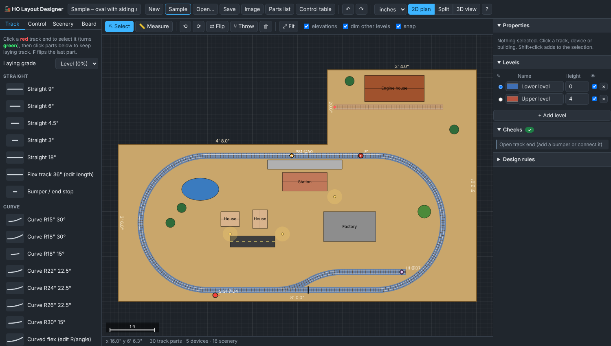

# 🚂 HO Layout Designer

**Try it:** https://hobbyistcanada.github.io/ho-layout-designer/

A free, browser-based planner for **HO scale (1:87.1)** model railroad layouts. Draw benchwork of any shape, lay generic sectional and flex track, stack multiple levels with grades, place signals and sensors, and check the result in 3D. There's nothing to install and no build step: it's plain HTML and JavaScript.



## Features

| Area | What you can do |
|---|---|
| **Benchwork** | Presets (rectangle, L, U, T/peninsula, hollow-core door, and a 96×42 + 20×40 L-shape) or **draw any polygon**. Drag corners, double-click an edge to add a corner, right-click a corner to delete it. Edge lengths and area are shown. |
| **Track library** | Generic HO track: straights (3–18"), editable flex, curves R15/18/22/24/26/30", editable curved flex, sectional 18R turnouts, #4 and #6 turnouts (L/R), #4 wye, curved turnouts, 30/45/90° crossings, bumpers, and a turntable with editable stall angles. |
| **Fast track laying** | Click a red open end to select it, then click parts in the library. Each part snaps on and the next open end is selected for you. **F** flips the last part (curve direction or turnout orientation). Dragging a part near an open end snaps it into place. |
| **Multi-level** | Any number of levels with colour, default height, show/hide and "dim other levels". Set a **laying grade** (for example +2%) and new track climbs as you lay it. Heights and grades are labelled on the plan. |
| **Control & sensors** | Turnouts get a position (normal/thrown), an address or pin, and a motor type. Place 2- and 3-aspect signals, dwarf signals, **train passing sensors** (IR/reed/Hall/…), **home / end-of-travel sensors**, occupancy-detection blocks, power feeders, insulated rail gaps, uncouplers and crossing gates. Everything snaps to the track and moves with it. |
| **Control table** | One table of every turnout, signal and sensor with its address or pin, exportable as CSV for wiring, Arduino sketches or JMRI. |
| **Scenery** | Houses, station, factory, engine house, water tower, platform, street lights, trees, roads, ponds, rivers, hills, mountains and tunnel portals. All are resizable and recolourable, and the real-world size is shown. |
| **Bridges** | Plate-girder bridge, through-truss bridge and timber trestle. Drop one on a track and it centres itself, lines up with the rails and takes the track's height; the 3D view draws abutments or trestle bents down to the ground instead of plain piers. |
| **Realism checks** | Physics and civil-engineering rules of thumb: the tallest car must clear the **underside** of the deck or bridge above (car height + deck thickness), **effective grade** on curves (grade + 32/R curve drag, John Allen's rule), **vertical kinks** where the grade changes abruptly, **S-curves** without a car-length straight, parallel tracks closer than 2" (sideswipe), buildings / trees / portals / bridge abutments and trestle bents **fouling the track**, track running through water, floating buildings, tunnel mouths without portals and raised track with no room for supports. |
| **Design checks** | Flags curves under your minimum radius, grades over your maximum, **too little vertical clearance** where levels cross, tracks overlapping at the same height, track running off the benchwork, open ends, and turnouts without an address. Click an issue to jump to it. |
| **3D view** | Three.js scene with benchwork, ballast, ties, rails, sub-roadbed and **piers under raised track**, scenery and signals (lit by aspect). Orbit, top view, **night mode** (street lights glow), a **test train** that follows connections and turnout settings and **stops or derails where a real train would** (hits a low deck or structure, runs off an open end or a misaligned joint, runs through a turnout set against it, S-curve, vertical kink, curve too tight, stalls on a steep curved grade, drives into water) with a message and a marker, and a **cab ride** camera in which turnouts show which way they are set. Raised track stands on posts that never land on a lower track (two-post bents beside the track where needed, as on a real helix); mountains get railway **cuttings** leading to the tunnel portals. |
| **Parts list** | Counts of sectional pieces, flex track needed (with 10% waste), joiners, devices and scenery, exportable as CSV. |
| **Files** | Autosaves in the browser. Save/Open `.json` projects you can keep in this repo. Export a PNG of the plan or the 3D view. Undo/redo (Ctrl+Z / Ctrl+Y). |

## Sample layouts

Click **Samples** for a gallery of ready-made plans. Each loads with track, signals, sensors and scenery, passes the design checks, and is also saved in [`examples/`](examples/) so you can open it with *Open…*.

| Sample | Size | Highlights |
|---|---|---|
| **Starter oval** | 8 × 3½ ft + plank | Oval with a siding and an upper-level spur; a quick tour of the tools. |
| **Over & under figure 8** | 13 × 5 ft table | One half climbs 4¼" (2.3%) so the track crosses over itself on a girder bridge; trestle approach; the low loop tunnels under a mountain. |
| **Spiral loop mountain division** | 16 × 8 ft island | Inspired by the Tehachapi Loop. A branch leaves the valley main, spirals inside a mountain and crosses over its own track, then climbs on a canyon trestle to a mining town. The valley has a continuous main, passing siding, 4-track yard and engine terminal. 3 levels. |
| **Two-deck helix railroad** | 14 × 11 ft room | Around-the-walls, two decks joined by a 3¾-turn R28" helix (15" rise). Lower-deck yard and town, upper-deck shelf with a truss bridge, trestle and mine terminal stacked above. |

The samples are generated in [`js/samples.js`](js/samples.js) with a small "turtle" that lays flex track so every loop closes exactly; run `node tools/export-samples.mjs` to refresh the `.json` copies after changing them.

## Run it

The app uses ES modules, so it has to be served over http (opening `index.html` straight from disk won't work).

- **GitHub Pages (easiest):** in the repo go to *Settings → Pages → Deploy from branch → `main` / root*. The app will be at **https://hobbyistcanada.github.io/ho-layout-designer/**.
- **VS Code:** install the *Live Server* extension, right-click `index.html`, then *Open with Live Server*.
- **Python:** run `python -m http.server 8000` in this folder and open http://localhost:8000.

The 3D view loads three.js from the jsDelivr CDN, so it needs an internet connection. The 2D planner works offline.

## Quick start

1. **Board** tab: pick a preset or draw your own outline.
2. **Track** tab: click *Straight 9"*. Its far end turns green. Keep clicking parts to extend the line. Click any red end to branch from there.
3. To build an upper deck, add or select a level on the right, make it active, set *Laying grade* to +2%, and lay the ramp.
4. **Control** tab: drop signals and sensors onto the track and give them addresses. Then open *Control table*.
5. Switch to **3D view** and press *Test train*.

### Keyboard & mouse

| Key | Action |
|---|---|
| Click red end | Select it as the attach point |
| F | Flip the last placed part |
| R / Shift+R | Rotate the selection 15° |
| T / double-click | Throw a turnout (or select a turntable stall) |
| Del | Delete the selection |
| Shift+click | Add to the selection |
| V / M | Select tool / Measure tool |
| Ctrl+Z / Ctrl+Y / Ctrl+S | Undo / Redo / Save |
| Esc | Cancel placing and clear the attach point |
| Wheel / drag empty / right-drag | Zoom / pan / pan |

## Project structure

```
index.html          UI layout + import map for three.js
css/style.css       styles
js/catalog.js       HO track geometry, devices, scenery, board presets
js/geometry.js      poses, arcs, sampling, intersections
js/model.js         project state, track graph & connections, undo, autosave
js/editor2d.js      canvas plan editor (snapping, laying, board editing)
js/checks.js        design-rule checks, parts list, control table
js/view3d.js        three.js scene, test train, cab ride
js/main.js          panels, properties, files, keyboard, sample gallery
js/samples.js       generated sample layouts (figure 8, spiral loop, helix)
js/realism.js       physics / clearance / structure rules, support posts, terrain cuttings, train movement
examples/           sample project files
tests/              sample checks (Node) and a browser smoke test (Playwright)
tools/              export-samples.mjs regenerates examples/*.json
```

## Tests

```
node tests/samples.test.mjs        # builds every sample, runs all checks and test trains everywhere
node tests/realism.test.mjs        # one deliberate fault per mini-layout: each must be caught
python3 tests/browser.test.py      # serves the app, loads each sample in Chrome, fails on JS errors
```

Units are inches internally (cm can be chosen for display). Track pieces are stored as a catalog id plus editable parameters, position, rotation, start height and grade, so the `.json` files stay small and are easy to compare in git.

## Roadmap ideas

- Helix generator (turns, radius and rise per turn, then auto-check clearance)
- Easements (spiral transitions) on curves and an S-curve warning
- Parallel-track spacing check (2" centres minimum in HO)
- Auto-detect electrical blocks from gaps; wiring diagram and reverse-loop warning
- Image underlay to trace a room photo or an existing plan; room walls, aisles and reach-in distance
- Printable 1:1 templates for turnouts and curves
- JMRI panel export and a DCC-EX / Arduino sketch generator from the control table
- Operations: industries, spots per siding and car-card generation
- Longest-train-per-siding calculator

## License

MIT, see [LICENSE](LICENSE).
